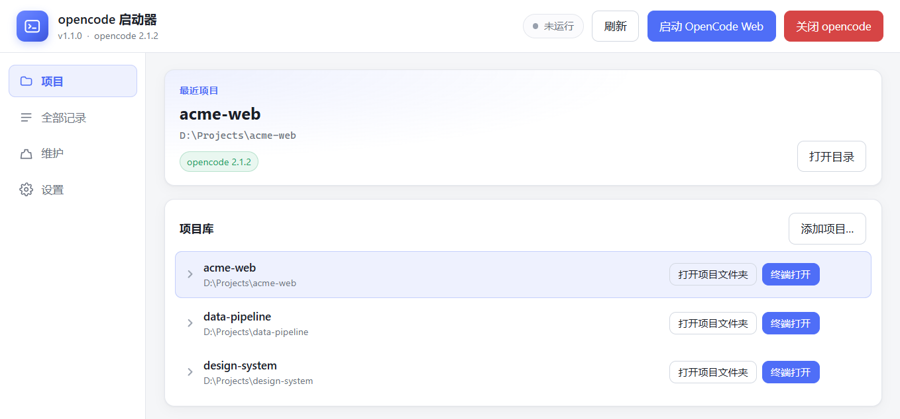

# opencode 启动器

为 [opencode](https://opencode.ai) 提供一个桌面入口：项目管理、会话续接、终端启动，以及一个**内置的 Web 界面**——不必再打开浏览器，也不必手动处理登录。




---

## 📖 目录

- [🖥 内置 OpenCode Web](#-内置-opencode-web)
- [🔄 项目管理：一处修改，处处同步](#-项目管理一处修改处处同步)
- [✨ 其他功能](#-其他功能)
- [📦 两个版本](#-两个版本)
- [🚀 安装](#-安装)
- [📘 使用说明](#-使用说明)
- [❓ 常见问题](#-常见问题)
- [🔧 技术说明](#-技术说明)
- [💻 开发](#-开发)
- [🤝 贡献](#-贡献)
- [📄 许可证](#-许可证)

---

## 🖥 内置 OpenCode Web

点击顶部的 **启动 OpenCode Web**，opencode 的 Web 界面会在启动器窗口内打开。**两个版本均支持**（桌面版使用内置 Chromium，轻量版使用系统 WebView2）。

| 能力 | 说明 |
|---|---|
| 免浏览器 | 界面内嵌于启动器，无额外依赖 |
| 自动登录 | 服务受密码保护，启动器自动换取一次性配对 cookie 后载入 |
| 项目自动对齐 | 打开时把启动器项目库写入 Web 的「工作区」面板 |
| 单例复用 | 重复点击不新建窗口，仅切换到前台并补一次同步 |
| 按需占用 | 窗口关闭即释放，不打开时零内存开销 |
| 一并关闭 | 「关闭 opencode」会同时销毁 Web 窗口、终端窗格与后端进程 |

### 为什么需要内置窗口

opencode 的 Web 界面存在**两套互不相通的项目数据源**：

| 界面 | 数据来源 |
|---|---|
| 设置 → 项目 | 服务端数据库（`opencode.db` 的 `project` 表） |
| 主界面 → 工作区 | 浏览器 localStorage（`opencode.global.dat:server`） |

启动器可以写入服务端，但无法写入浏览器的 localStorage——这是「设置页列出了一堆项目，工作区却是空的」的根本原因。localStorage 没有服务端副本，URL 参数、深链接、`postMessage` 均不会触发持久化。

内置窗口的做法是让脚本运行在 `127.0.0.1:<port>` 这一源下，按 Web 端自身的数据结构写入项目列表——效果等同于手动「添加项目」，只是全自动完成。

> 写入时会同步清理：上一轮由启动器写入、本轮已不在项目库中的条目会被移除；用户自行在 Web 端添加的项目不受影响。

## 🔄 项目管理：一处修改，处处同步

**启动器项目库是唯一真相源。** 在启动器中新增、删除、重命名项目，Web 与终端随之变化；在 Web 或终端中所做的修改，会在启动器启动或点击「刷新」时回收。

| 情况 | 处理方式 |
|---|---|
| 服务端有、项目库无 | 加入项目库（在 Web 或终端新建的项目） |
| 项目库有、服务端无、上次同步时存在 | 判定为在别处被删除，从项目库移除 |
| 项目库有、服务端无、上次同步时也不存在 | 视为新项目，登记到服务端 |
| 两边都有 | 以服务端的项目名为准（重命名发生在该侧） |

删除会同步到 opencode：移除项目时一并删除其 `project` 记录与名下会话，**磁盘文件不受影响**，操作前有二次确认。

同步过程还会修正两类历史问题：`project_id` 被写成 `global` 的会话会重新挂回所属项目；同一目录因大小写不同产生的重复项目行会被合并。

以下目录不会被识别为项目：用户主目录本身、系统临时目录及其子目录、盘符根目录、opencode 的 `global` 伪项目。opencode 启动后台服务时会将自身工作目录登记为项目，这类记录会被过滤，不会出现在列表中。

## ✨ 其他功能

### 📁 项目

- 一键打开项目文件夹，或在该目录下启动终端
- 最近项目列表，支持快速切换
- 自动识别 Git 仓库，显示分支、领先/落后提交与改动统计

### 💬 会话

- 展开项目查看全部会话：标题、消息数、更新时间、所用模型
- 选中会话后启动即**续接**，未选中则开启新会话
- 行内重命名（回车保存）与删除，双击直接续接
- **全部记录**视图列出 opencode 中的全部项目与会话，包括不在项目库中的目录；支持搜索、重命名、删除，或一键加入项目库

### ⌨️ 终端

- 每个会话在独立、可见的终端窗口中启动，不占用现有终端
- 支持 Windows Terminal、命令提示符、PowerShell，可附加启动参数

### 🛠 维护

- 查看已安装版本与最新版本
- 安装 / 修复、更新、卸载 opencode
- 缓存占用分类统计与清理
- 内置环境自检

## 📦 两个版本

| | 桌面版（Electron） | 轻量版（Tauri） |
|---|---|---|
| 渲染内核 | 内置 Chromium | 系统 WebView2 |
| 安装包 | ~83 MB | **~1.8 MB** |
| 运行时依赖 | 无 | 系统需具备 WebView2（Windows 10/11 通常自带） |
| 内置 Web 支持 | 支持 | 支持 |
| 内置 Web 内存增量 | 约 +166 MB | 约 +234 MB |
| 源码目录 | `desktop/` | `tauri/` |

两个版本功能一致。轻量版体积小一个数量级，适合日常使用；桌面版在频繁使用内置 Web 界面时更稳妥。

> 内存增量为窗口打开期间的实测值，关闭窗口后释放，未打开时为 0。

## 🚀 安装

从 [Releases](https://github.com/Xwei-nobug/OpenCode-Launcher/releases) 下载：

| 资产 | 说明 | 大小 |
|---|---|---|
| `opencode-launcher-light-setup.exe` | 轻量版安装器（推荐） | ~1.8 MB |
| `opencode-launcher-setup-x.y.z.exe` | 桌面版安装器 | ~83 MB |

双击运行，选择安装位置，按提示完成即可。安装包自带运行环境，**无需预装 Node.js 或其他依赖**。

首次使用时若提示未安装 opencode，点击「安装 / 修复」即可：检测到 npm 时通过 npm 安装，否则直接下载官方发行版。

## 📘 使用说明

1. 添加项目目录（或直接在「全部记录」中把已有目录加入项目库）
2. 点击 **启动 OpenCode Web** 使用 Web 界面，或点击项目行内的 **终端打开** 使用终端
3. 顶部 **刷新** 会与 opencode 同步一次项目库，并重新读取项目与会话列表

- 关闭启动器窗口即退出程序，正在运行的 opencode 会话不受影响
- 需要结束 opencode 时，使用顶部的 **关闭 opencode**
- 项目库、偏好与日志存放于 `%APPDATA%\opencode-launcher\`

## ❓ 常见问题

**Web 工作区为什么不显示我的项目？**

因为该面板读取浏览器 localStorage，与「设置 → 项目」的服务端数据源无关。使用启动器的内置窗口打开即可自动对齐；用普通浏览器打开时无法写入。

**删除项目会删除磁盘文件吗？**

不会。删除的只是 opencode 中的 `project` 记录及其名下会话，磁盘目录原样保留。

**关闭窗口会中断正在运行的任务吗？**

不会。关闭启动器只退出界面，opencode 会话继续运行。只有「关闭 opencode」会结束它们。

**需要预先安装 Node.js 吗？**

不需要。安装包自带运行环境；轻量版依赖系统 WebView2，Windows 10/11 一般已内置。

**支持 macOS 或 Linux 吗？**

目前只提供 Windows 安装包。代码本身未使用 Windows 专有 API 的部分可以移植，但尚未适配。

**为什么列表里偶尔会多出一个不是自己添加的项目？**

opencode 启动后台服务时会把自身工作目录登记为项目。启动器会过滤用户主目录、临时目录与盘符根目录，因此这类记录不会显示。

## 🔧 技术说明

### 数据存储

| 数据 | 位置 |
|---|---|
| 项目库、偏好 | `%APPDATA%\opencode-launcher\config.json` |
| opencode 会话与项目 | `~/.local/share/opencode/opencode.db`（SQLite，WAL） |
| Web 工作区面板 | 浏览器 localStorage（`opencode.global.dat:server`） |

### 工作区同步

合并规则只有一份实现：`shared/web-seed.js`。桌面版在运行时读取该文件，轻量版通过 `include_str!` 编译内嵌，两端行为保持一致。

写入采用「标记 + 清扫」策略：记录上一次由启动器写入的目录集合，本轮不在集合中的条目移除，其余保留，从而区分「用户删除」与「用户自建」。

## 💻 开发

### 桌面版（Electron）

```bash
cd desktop
npm install
npm start              # 开发运行
npm run test:backend   # 后端测试
npm run test:ui        # Playwright 端到端测试（真实窗口）
npm run dist           # 打包 -> desktop/dist/（仅保留安装包）
```

### 轻量版（Tauri）

需要 Rust stable（`rustup`）与 MSVC 构建工具（Visual Studio Build Tools 的 C++ 工作负载）。

```bash
cd tauri
npm install
npm run dev            # 开发运行
npm run dist           # 打包 -> tauri/dist/（仅保留安装包）
npm run collect        # 仅归位已构建产物，不重新编译
node test/full-test.mjs            # 功能测试（49 项，Playwright + mock IPC）
node test/session-pick-test.mjs    # 会话选择交互测试
cd src-tauri && cargo test         # 后端单元测试
```

Rust 后端位于 `tauri/src-tauri/src/`（`core.rs` 业务逻辑，`main.rs` 命令层）。前端复用 `desktop/renderer/`，由 `tauri/renderer/bridge.js` 将 IPC 通道映射为 Tauri 命令。

> 打包路径需为纯 ASCII 且不含空格。路径中若包含中文或空格，NSIS 可能报错或产出异常大小的安装包。

### 发布

```bash
node scripts/publish-release.mjs v1.1.0 --notes docs/release-notes-v1.1.0.md \
  desktop/dist/opencode-launcher-setup-1.1.0.exe \
  tauri/dist/opencode-launcher-setup.exe:opencode-launcher-light-setup.exe
```

Token 由本机 git 凭据管理器提供；同名资产会被替换，脚本可重复执行。`node scripts/list-releases.mjs` 可列出各版本及其资产。

## 🤝 贡献

欢迎提交 Issue 与 Pull Request。提交前请确保：

- `npm run test:backend` 与 `node test/full-test.mjs` 通过
- 涉及界面改动时附上截图
- 提交信息使用 `feat:` / `fix:` / `docs:` 前缀

## 📄 许可证

[MIT](LICENSE)
